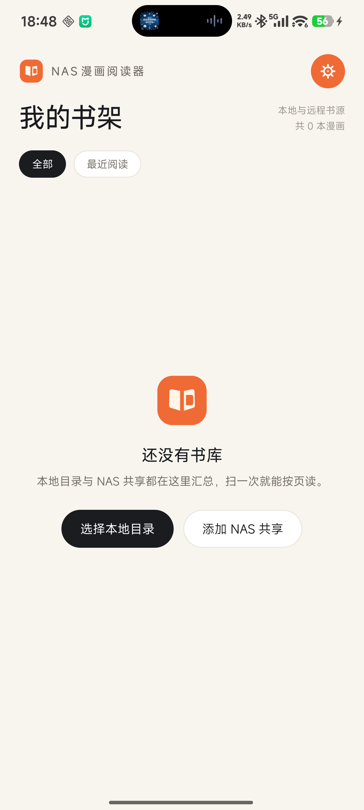
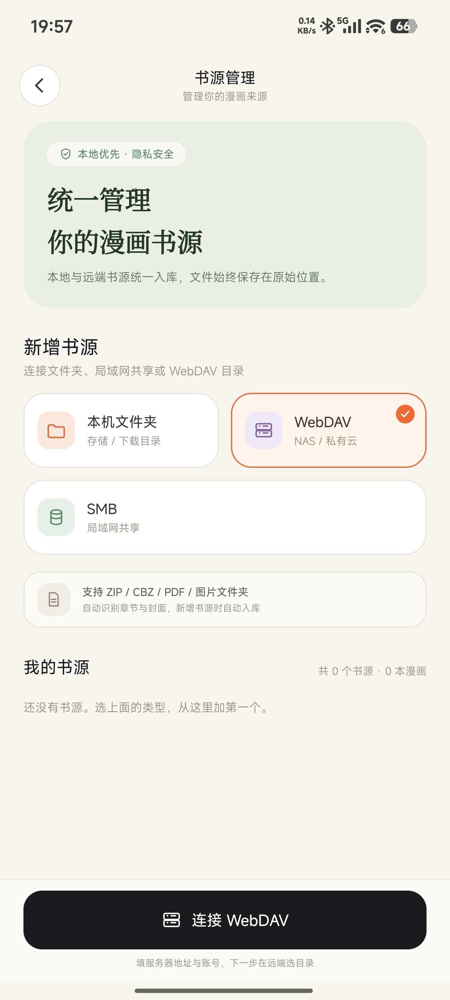

  
  <h1>NAS漫画阅读器</h1>
  
<b>本地漫画阅读器</b>

  

    
    
    
  

  
<a href="https://github.com/tmadmao/nascomicreader/stargazers">⭐ 觉得好用，点个 Star 吧</a>

> 手机目录、WebDAV、SMB 都能当书库；压缩包不用解压，点开就是书。  
> 书留在你自己的设备上：没有账号，不上传书目，不统计阅读行为。

## 目录

- [下载](#下载)
- [界面预览](#界面预览)
- [主要功能](#主要功能)
- [支持的格式](#支持的格式)
- [快速开始](#快速开始)
- [常见问题](#常见问题)
- [捐助](#捐助)
- [更多](#更多)

## 下载

| 渠道                                                                           | 说明                                  |
| ---------------------------------------------------------------------------- | ----------------------------------- |
| [GitHub Releases](https://github.com/tmadmao/nascomicreader/releases/latest) | 最新正式版，当前 **1.6.0**（versionCode 32）  |
| 应用内「检查更新」                                                                    | 读取更新清单，下载后校验 SHA-256 与签名证书，再交给系统安装器 |

需要 Android 7.0 及以上。

## 界面预览

|                        书架                       |                        书源管理                       |
| :---------------------------------------------: | :-----------------------------------------------: |
|  |  |

## 主要功能

### 书库

- 三种来源：本机目录（系统文件选择器授权一次）、WebDAV、SMB2/3；重扫可增量更新，也可中途取消
- 新增来源必须选书型：**连载漫画**（子文件夹 / 压缩包 / PDF 当章）或 **单行本·图集**（每个含图目录各自成书）
- 书架：大标题 + 通栏搜索（按书名或来源，范围可切全部 / 作品系列 / 作家）+ 最近阅读 / 作品系列 / 作家列表入口 + 继续阅读卡 + 书源分段 + 3 / 6 列封面网格
- 长按可多选、重命名、换封面、从书库删除、加入系列；这些只动应用里的记录，**不碰硬盘或 NAS 上的源文件**
- 包内若带 `ComicInfo.xml`，进详情时读一次作者与卷号：只填空着的或仍停在文件名解析值的栏，手动改过的不动；没有这份文件的包照旧从书名解析
- 作品系列默认关闭，打开后自动归拢高置信度的同系列卷，也可手动加入或移出

### 阅读

- 横向翻页（左右语义可切）与竖向连贯滚动；整页显示，点两侧翻页、中间呼出工具栏
- 双页并排四档组屏、跨页大图拆分、扫描件裁白边、分区点击、音量键 / 滚轮 / 滑动翻页
- 双击 / 双指 / 长按缩放，页面适应可按宽度或完整显示；49 项阅读参数，支持按书覆盖
- 目录与书签：详情页与阅读抽屉各有一份目录，正倒序可切；当前页可加书签，详情页可跳回
- 进度记到「第几章第几页」，重进接着看；阅读菜单里的进度条整条可拖，跟随阅读方向镜像
- 超过六百万像素的大图先出低清预览，完整图随后替换同一位置；预览只用于显示，不进缓存

### 缓存与性能

- 前后各 0–12 页预载；远端书另有 1–5 GB 磁盘页缓存，读过的页下次不必重新下载
- 原尺寸解码、32 位颜色解码、内存上限等选项按设备性能自行调整；设置里可看占用并一键清空

### 设置

- 两级：分类索引 → 阅读 / 缩放 / 版面 / 性能与存储 / 通用；冷参数收在每页底部「高级设置」，原地展开
- 改动立即生效；从阅读页进入时只改当前这本，也可以恢复默认

## 支持的格式

| 类型             | 说明                                          |
| -------------- | ------------------------------------------- |
| zip / cbz      | 自解析包目录，不解压、不整包读进内存；支持 ZIP64，单包与条目偏移都能超 4 GB |
| 7z / rar / cbr | 由 libarchive 读取，远端压缩包也能直接打开                 |
| tar            | 解析标准 tar 头，支持长文件名                           |
| PDF            | 按屏幕尺寸现场渲染                                   |
| EPUB           | 按书脊顺序取图                                     |
| 散图文件夹          | 按文件名自然序排列：`第2话` 在 `第10话` 之前                 |

压缩包按内容判断类型，扩展名写错也能打开；封面取自然序第一张。

## 快速开始

1. 安装后打开，空书架时点「选择本地目录」，用系统文件选择器授权一个放漫画的文件夹
2. 用 NAS：设置 → 书源管理 → 选 WebDAV 或 SMB → 先选书型（连载 / 单行本·图集）→ 填地址与账号 → 在远端目录树里点进要当书库的文件夹 →「使用此文件夹」
   - WebDAV：选 HTTP / HTTPS，填服务器与端口（例如 `192.168.1.10` + `5005`）
   - SMB：填地址与端口（例如 `192.168.1.10/漫画`），账号可写 `域\账号`，留空按访客连
3. 回到书架等扫描完成；封面底边一条线表示读到哪里，点开接着看

## 常见问题

**会修改我的漫画文件吗？** 不会。重命名、换封面、删除、加入系列都只改应用里的记录，源文件保持原样。

**需要账号或联网吗？** 不需要登录，也不上传书目。本地书源离线可用；自动或手动「检查更新」会联网读取更新清单。

**大压缩包或 NAS 上的书能直接读吗？** 能。zip / cbz 与 tar 自解析，7z / rar / cbr 走 libarchive；读过的页会留在本机缓存。

**书很多，扫描会不会把书库冲掉？** 一条都没扫到时保留原书库，不会把书删掉；重扫只报新增 / 更新 / 移除的数量。

## 捐助

如果这个项目帮到了你，欢迎[请我喝咖啡 ☕](https://cdn.loli.sh/sponsor/sponsor.html)。支持支付宝、微信、Ko-fi。  
随心就好，赞助不换取任何功能优先权，也不改变 issue 的处理顺序。

## 更多

- [更新记录](CHANGELOG.md)
- [开源许可](LICENSE)（Apache-2.0）；第三方组件见 [NOTICE](NOTICE)，应用内「设置 → 关于 → 开源许可」也可查看
- 问题与建议：[Issues](https://github.com/tmadmao/nascomicreader/issues)
